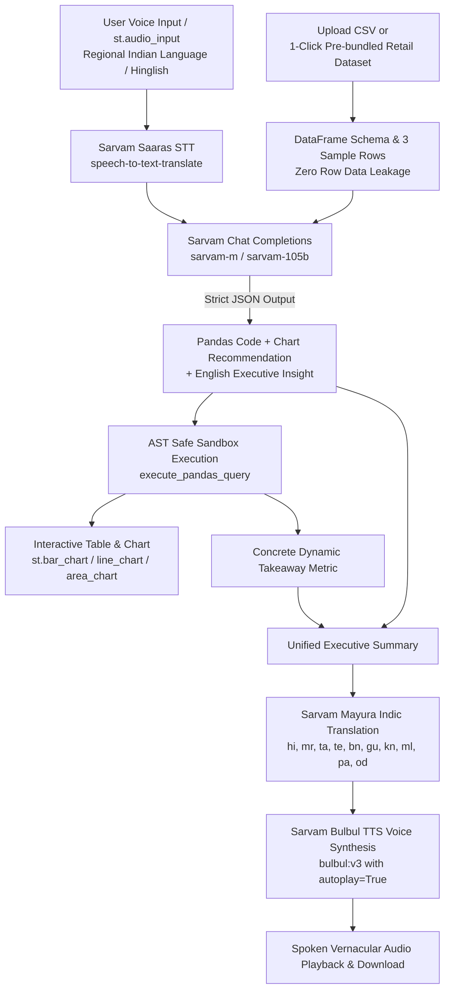

# 🎙️📊 VaaniData: Vernacular Talk-to-CSV & Pandas Voice Analyst
**India's First Voice-Powered Vernacular Quant & BI Analyst Powered by Sarvam AI**

[](https://streamlit.io/)
[](https://pandas.pydata.org/)
[](https://www.sarvam.ai/)
[](https://python.org/)

---

## 🌟 Overview & Problem Statement
Over **800 Million Indians** communicate in regional languages and Hinglish, and more than **63 Million MSMEs** generate vast amounts of structured transactional data. Yet, enterprise analytics platforms (Tableau, PowerBI, Excel, Pandas, Databricks) demand English fluency and SQL/Python programming expertise.

**VaaniData** bridges this digital divide. It enables business owners, regional managers, and non-technical stakeholders to talk to any CSV dataset in their native mother tongue—generating instant visual charts, data tables, and natural spoken vernacular voice briefings.

---

## 🎯 Core Architecture & User Flow



### 1. Data Ingestion
- Upload any custom `.csv` file.
- **1-Click Load Sample Indian Retail Dataset** (`sample_data.csv` pre-bundled with 350 transactions across 12 Indian cities, electronics, apparel, grocery, UPI/EMI metrics, and delivery times).

### 2. Vernacular Voice or Text Input
- Record spoken voice queries using `st.audio_input` in Hindi, Hinglish, Marathi, Tamil, Telugu, etc.
- Or type queries directly or use pre-built 1-click sample chips.

### 3. Sarvam Saaras (Speech-to-Text Translate)
- Transcribes and translates regional spoken audio directly into an English analytical prompt using `https://api.sarvam.ai/speech-to-text-translate`.

### 4. Sarvam Chat Completions (`sarvam-m`)
- Transmits **ONLY** the DataFrame schema (`df.columns`, `df.dtypes`, and 3 sample rows) to `https://api.sarvam.ai/v1/chat/completions`.
- Generates a strict JSON payload containing:
  - `pandas_code`: Single-line Python expression with `df`.
  - `chart_type`: `"bar"`, `"line"`, `"area"`, or `"none"`.
  - `x_col` & `y_col`: Dimension and metric column names.
  - `english_insight`: 2-sentence executive summary.

### 5. AST Safe Execution & Auto-Visualization
- Statically validates code against security vulnerabilities (blocks imports, eval, file system access).
- Renders the resulting data table with a 1-click CSV download.
- Plots the recommended chart (`st.bar_chart`, `st.line_chart`, or `st.area_chart`).
- Computes a concrete, dynamic 1-sentence data takeaway from the top row or metric and appends it to the executive summary.

### 6. Sarvam Mayura (Translation) + Bulbul (TTS)
- Translates the executive insight into the user's chosen Indian language using `https://api.sarvam.ai/translate` with selectable modes (`modern-colloquial`, `formal`, `code-mixed`).
- Synthesizes natural spoken voice audio using `https://api.sarvam.ai/text-to-speech` (`bulbul:v3` with automatic multi-model fallback).
- Plays the audio back automatically with `autoplay=True` and provides a one-click audio download.

---

## 🚀 Quickstart Guide

### 1. Clone & Navigate to Repository
```bash
git clone <repo_url>
cd Sarvam
```

### 2. Install Dependencies
```bash
pip install -r requirements.txt
```

### 3. Configure API Credentials
Create a `.env` file or export your key:
```env
SARVAM_API_KEY=your_sarvam_api_key_here
```
*(Alternatively, enter your key directly in the application's sidebar with password masking).*

### 4. Run the Web Application
```bash
streamlit run app.py
```
Open `http://localhost:8501` in your browser.

---

## 💡 Sample Queries for Testing

| Language / Dialect | Sample Query | Output Chart |
|---|---|---|
| **Hinglish** | *"Top 5 cities by revenue dikhao aur bar chart plot karo"* | Bar Chart |
| **Hinglish** | *"Monthly revenue trend line chart mein dikhao"* | Line Chart |
| **Hindi** | *"सबसे ज्यादा मुनाफा (profit) देने वाली कैटेगरी कौन सी है?"* | Bar Chart |
| **Hinglish** | *"UPI aur Credit card payment modes ka comparison dikhao"* | Grouped Bar |
| **English** | *"Which customer segment generates the highest average order value?"* | Metric / Bar |
| **Analytical** | *"Top 5 products with highest ratings and quantities sold"* | Data Table & Bar |

---

## 🛡️ Security & Privacy Architecture
- **Schema-Only LLM Context:** Raw user rows are never sent across the network to the LLM. Only column names and data types are passed.
- **AST Static Code Sanitization:** AST parsing prevents execution of `os`, `sys`, `eval`, `exec`, or file system operations.
- **Resilient Fallback Engine:** Features zero-crash failover mechanisms for TTS audio and offline heuristics for hackathon judging under network constraints.

---

## 👥 Built with Sarvam AI
Built for the Sarvam AI Hackathon, celebrating vernacular data democratization across Bharat 🇮🇳.
